<div align="center">



<br/>

<a href="mailto:alitrmlzxyz@gmail.com">
  
</a>
<a href="https://discord.com/users/411683787546558485">
  
</a>
<a href="https://github.com/altrml">
  
</a>

</div>

---

### `> whoami`

```c
typedef struct rat {
    const char *name   = "alyyy";
    const char *handle = "altrml";
    const char *mail   = "alitrmlzxyz@gmail.com";
    const char *focus  = "systems, reverse engineering, low-level";
    const char *stack[5] = { "C++", "Rust", "Python", "C#", "Go" };
    const char *status = "building something that shouldn't exist";
} rat_t;
```

Baca binary, bongkar protocol, tulis ulang dari metal ke atas.
Kalau dokumentasinya bohong, packet capture yang jawab.

---

### `> arsenal`

| Lapisan | Isi |
| :--- | :--- |
| `low-level` | C · C++ · Rust · x86-64 · Windows internals |
| `high-level` | Python · C# · Go · TypeScript |
| `wire` | Ghidra · Wireshark · Neovim · Git · Docker |
| `platform` | Windows · Linux · Ghostty · WSL |

---

### `> metrics`


<sub>Dihitung ulang tiap 03:00 UTC oleh workflow di repo ini. Commit, bintang, bahasa — semua dari API, bukan gambar dari server orang.</sub>

---

### `> activity`



<sub>Kotaknya penuh sendiri. Satu malam, satu commit, satu kotak.</sub>

---

### `> contact`

<div align="center">

<a href="mailto:alitrmlzxyz@gmail.com">
  
</a>
<a href="https://discord.com/users/411683787546558485">
  
</a>

<br/><br/>

<code>response time: as fast as the scent allows</code>

<br/><br/>


</div>
